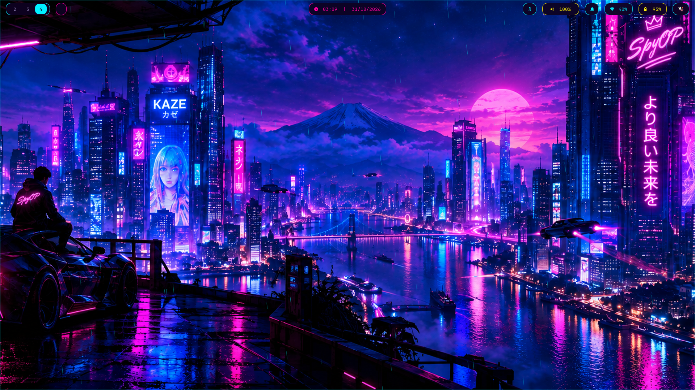

# Hyprland cyberpunk rice

A Hyprland setup for Arch-based systems (built on Garuda): neon cyberpunk by default, with macOS, red and green themes you can switch to on the fly.



## Features

- Desktops shared across two monitors (switching one switches both)
- Floating pill Waybar with audio, Bluetooth, battery/brightness panel and cava visualizer
- Theme switcher: cyberpunk, macOS, red, green (`Super+Shift+1-4`)
- Rain overlay on the wallpaper, neon lock screen, clipboard history, screenshot editor, dropdown terminal
- `install.sh` with backups and a `--dry-run` mode

## Install

```bash
git clone https://github.com/Spy1198/dotfiles.git
cd dotfiles
./install.sh --all --dry-run   # see what it will do
./install.sh --all
```

Existing configs are copied to `~/.dotfiles-backup/<timestamp>/` first.

## Before you run it

- **Monitor names:** the config assumes `eDP-1` (left) and `HDMI-A-1` (right). Change them in `config/hypr/hyprland.conf` and the Waybar config.
- **Wallpapers:** not included. Put `cyberpunk.png`, `macos.png`, `red.png` and `green.png` in `~/Pictures/Wallpapers/`.
- **Hardware fixes:** `./install.sh --msi-bravo15` installs a USB controller workaround for one specific laptop. Skip it on other machines.

## Keybinds

| Keys | Action |
| --- | --- |
| `Super+Q` / `Super+Return` | Terminal |
| `Super+R` | App launcher |
| `Super+L` | Lock screen |
| `Super+1..0` | Jump to desktop |
| `Ctrl+Alt+Left/Right` | Previous/next desktop |
| `Ctrl+Alt+Shift+Left/Right` | Move window to previous/next desktop |
| `Super+Shift+Left/Right` | Move window to the other monitor |
| `Super+Shift+1-4` | Switch theme |
| `Super+Shift+S` | Screenshot with editor |
| `Super+V` | Clipboard history |
| `F12` | Dropdown terminal |

## Keeping the repo updated

Run `./sync.sh` to copy your live configs back into the repo.

## License

MIT
